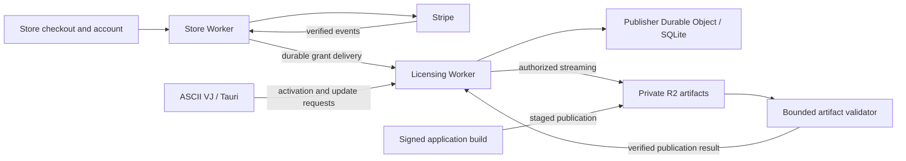

# Software licensing, subscriptions, and private updates

Updated November 9, 2026. Store's test-only licensing/billing/management and
recovery implementation is merged; the licensing consumer is published privately.
Deployed-source drain/capture/resume and the protected off-account encrypted
round trip to an isolated Cloudflare restore target passed on the reviewed merged
sources. Stripe test-browser 3DS, hosted card replacement, failed-renewal recovery
through public webhooks and three approved-recipient Resend deliveries now have
separate sandbox evidence in [Store PR #126](https://github.com/aindaco1/store/pull/126)
(merged after the full hosted CI gate passed). Cleanup was verified and production
remained unchanged.
The subsequent administration phase is merged in Store PR #127 and private
licensing PR #2: atomic key
replacement, device deactivation/reset, release withdrawal, bounded history and
schema 4 encrypted recovery. Fresh provider runs close the signed replay evidence
gap and verify the early-webhook KV checkpoint fix. The protected off-account
rehearsal [passed on the merged schema 4 sources](https://github.com/aindaco1/store/actions/runs/42453190850),
including source/target cleanup. The implementation record below
owns current publication and acceptance status; this is not a production rollout.
**Paid Entitle sales, production licensing and scheduled licensing capture stay
disabled.** See the [implementation record](software-licensing-implementation.md)
for exact commits, run evidence, current boundaries, remaining gates and the next
execution sequence. Historical checkpoints below retain their original scope;
they do not supersede that current record.

A separately authorized free [ASCII VJ Remix 1.3.3 release](https://github.com/aindaco1/ascii-vj-remix/releases/tag/v1.3.3)
now delivers the distribution notices and corresponding sources. Its public
installer/updater gates passed on all three platforms. Consumer-owned release
evidence and remaining paid-launch gates are linked from the current
implementation record; this does not enable paid licensing or scheduled capture.

Server-secret hardening is merged in Store PR #128 and private licensing PR #3:
bounded service/capture
credential overlap, versioned activation signers, complete-key-set recovery proofs,
and the existing Store admin running against a disposable local fixture. License
administration has its own **Licenses** tab, using the dashboard styling and
localized info bugs. Store's
`docs/SOFTWARE_SERVER_SECRETS.md` owns the operator procedure. The stable customer
key derivation root is recovered unchanged. Store PR #129 fixes activation of bulk
secret updates through the existing immediate Durable Object deployment. After
full CI, the protected [off-account rehearsal passed](https://github.com/aindaco1/store/actions/runs/42462794992)
on the merged sources, including signing-key recovery, service credential overlap
and retirement, retired-token denial, customer-key recovery and source/target
cleanup. Its downloaded receipt matches GitHub's artifact digest. Compatible
signed-client activation/reactivation now also passed in a disposable Volver Health
Developer ID-signed pilot, including same-seat reactivation, signed update/restart
and offline rendering. The distribution/licensing groundwork merged in ASCII VJ
Remix PR #53 after all four Desktop CI jobs passed; local probe controls merged in
licensing PR #4 after its CI passed. Both merged trees match their tested heads,
and the unchanged app version caused automatic release dispatch to be skipped.
See the implementation record for exact evidence and remaining release gates. Next are
capacity/abuse limits, peak-memory profiling and retention/recovery objectives.
No additional secret store, capture schedule or production licensing deployment
was introduced. Ordinary encrypted backups remain enabled.

The first product is **ASCII VJ Remix**. Build reusable infrastructure for the
rest of the portfolio, but migrate no other application in this first rollout.
Use the existing Store checkout. Keep all new application hosting, durable
state, and artifact delivery on Cloudflare. Stripe remains the payment provider;
the existing Resend plan and platform-specific signing/build systems remain
external dependencies, not additional application hosting.

Support monthly and annual subscriptions, complimentary licenses, and all three
one-time update policies: a defined coverage period, a purchased major version,
and lifetime updates for the purchased product. Customers must be able to buy
merchandise, a ticket, and a software license in one Store purchase with one
initial payment, including when the software offer is recurring. These are
confirmed launch requirements. Subscription expiration must never disable
installed functionality. The commercial offering is paid future builds,
updates, and support. The first paid version and prices remain product decisions.

Platform changes remain documentation-only. New product behavior lives in
ASCII VJ Remix, Store experiments and the separate `dust-wave-licensing` consumer.
No shared package extraction or Platform version bump is justified yet.

## Recommendation

Adapt Entitle's licensing and update protocol in a **small Cloudflare service
owned by a consumer repository**, then extract characterized integration
mechanics into Platform. Store owns checkout and financial reconciliation;
the service owns licenses, activations, and authorization of private releases.
Applications retain their existing updater, signing, local storage, and UI.

Keep current adapters in their consumer repositories. Worker Core already owns
bounded provider transport; extract a new provider module only after actual
consumer overlap and before/after characterization justify it. A new general-purpose `commerce-core` or `licensing-core` package is
not justified yet. Keep the adapted Entitle server implementation outside this
MIT repository, with its own applicable licenses and notices.

This is a substantive adaptation, not a drop-in installation. Do not promise
upstream's complete API, dashboard, or operational compatibility. Preserve the
client endpoints we actually use and explicitly version Dust Wave extensions.
The initial paid release must support all agreed billing models; implement and
verify them in small increments before enabling live sales.

## Reviewed evidence and important mismatches

Platform baseline: `d33b417131512c5607919699ebc8eb0f3ba66700`.
Entitle baseline: [`9bc5afe6a99b9e23cf41bb92042dddf15c6b8e54`](https://github.com/doublesharp/entitle/tree/9bc5afe6a99b9e23cf41bb92042dddf15c6b8e54).
Store baseline: `5e8d27fa7e85d6acaf2983c901fafd41c3ce8a8e`.
ASCII VJ baseline: `eebf5bdca6c88c66a04cacd9a2a8256112880fdb`.
These are inspected source revisions, not new production acceptance results.

The review covered Platform's contributor rules, architecture decisions,
capability catalog, consumer pin/rollback workflow, runtime trust policy,
Worker/Tax/Inventory/Release/Desktop references, and relevant implementations.
It also covered Store's checkout, order, download, security, and shared-checkout
contracts; ASCII VJ's manifest, updater configuration, release tests, licensing
provenance, and local-first constraints. Upstream review included deployment,
configuration, licensing, billing, activation, client adapters, release formats,
webhooks, backup, tests, and the source behind the public guide. The linked
website was unavailable through the research reader; its current source uses
`#self-hosting` rather than the supplied `#self-hosted-setup` anchor.

| Finding | Consequence |
| --- | --- |
| Entitle uses Fastify, Knex, SQL transactions, database jobs, SMTP, and local artifact spools. | Port the required boundaries; do not import the server into a Worker package. [Architecture](https://github.com/doublesharp/entitle/blob/9bc5afe6a99b9e23cf41bb92042dddf15c6b8e54/docs/architecture.md). |
| Its paid checkout validates annual recurring prices. | Monthly and one-time grants require explicit new behavior and independent billing tests. [Validation](https://github.com/doublesharp/entitle/blob/9bc5afe6a99b9e23cf41bb92042dddf15c6b8e54/src/stripe.ts). |
| Store settles immediate purchases through PaymentIntents; Pool uses setup-mode Checkout and later settlement. | Preserve both existing models. Add a recurring software path in Store; do not turn Pool or every Store purchase into a subscription. |
| Entitle expects its own customer sessions and checkout flow. | A server proxy alone does not supply customer identity. Keep buyer recovery and ownership checks in Store. [API](https://github.com/doublesharp/entitle/blob/9bc5afe6a99b9e23cf41bb92042dddf15c6b8e54/docs/api.md). |
| Entitle is source available under ELv2 plus a publisher permission; client examples have separate permissive terms. | Preserve provenance and notices; never copy server/business code into an MIT Platform package as though it were MIT. Use the documented publisher-control rationale below; re-review if ownership, control, or service audience changes. [Terms](https://github.com/doublesharp/entitle/blob/9bc5afe6a99b9e23cf41bb92042dddf15c6b8e54/ADDITIONAL-PERMISSION.md), [license guide](https://github.com/doublesharp/entitle/blob/9bc5afe6a99b9e23cf41bb92042dddf15c6b8e54/docs/licensing.md). |
| ASCII VJ's inherited license is MIT **with an Anti-Advertisement Restriction**, not standard MIT. | Paid distribution appears compatible; in-app marketing and customers' advertising/sponsored-display workflows need separate resolution. See the [license assessment](#ascii-vj-remix-license-assessment) below. |
| Entitle pins Node 26.12.0, below Platform's patched minimum. | Any retained Node validation image/tooling needs a tested 26.12.1+ pin, lockfile compatibility, image digest, and runtime trust checks. [Manifest](https://github.com/doublesharp/entitle/blob/9bc5afe6a99b9e23cf41bb92042dddf15c6b8e54/package.json), [Platform policy](security-runtime-trust.md). |
| Existing ASCII VJ releases point at a public GitHub updater feed. | A paid feed does not make already-public binaries private. Introduce an explicit free-to-paid transition and prevent new paid bytes from being published by the old workflow. |

## ASCII VJ Remix license assessment

The consumer now owns the detailed review in
`ascii-vj-remix/docs/proposals/paid-distribution-review.md`, with artifact evidence
in its adjacent `evidence/paid-distribution-2026-11-04.json`. These are local
working drafts, not published customer terms. Keep customer language and
component compliance materials in that consumer; Platform owns no product EULA.

The draft identifies **Fumblers LLC dba Dust Wave** as publisher and explicitly
excludes advertising, sponsored-content, and commercial-marketing workflows.
It retains the inherited license, supplies prohibited-use examples and factual
coverage UI, and distinguishes ordinary subscription expiry from termination
for a prohibited use. Draft disclosures do not independently guarantee
compliance or authorize uses the underlying license prohibits. The fork's
[retained license and provenance](https://github.com/aindaco1/ascii-vj-remix/blob/eebf5bdca6c88c66a04cacd9a2a8256112880fdb/docs/CONTRIBUTORS.md#license)
remain authoritative; upstream's later AGPL/MIT split was not adopted.

The publisher confirmed sole control of ASCII VJ Remix's official roadmap,
release decisions, pricing, and support terms, with no client/partner approval
rights. The memo documents why those facts support Entitle's
[Your Software definition and publisher permission](https://github.com/doublesharp/entitle/blob/9bc5afe6a99b9e23cf41bb92042dddf15c6b8e54/ADDITIONAL-PERMISSION.md).
Eligibility concerns the maintained ASCII VJ product, not mere possession of an
Entitle fork. It is an interpretation of the published permission, not special
approval from Doublesharp. No Entitle service has been implemented.

The investigation hash-verified and inspected all seven substantive 1.3.2
installer/update artifacts. It found missing standalone app/Unifont/full FFmpeg
license resources, incomplete demonstrated source delivery, and a need for
reviewed per-target dependency notices/source materials. AppImage adds a
substantial native-library distribution surface. NDI/Syphon and Platform
notices are present; NDI's end-user agreement, SDK applicability, and font
redistribution evidence still need the consumer's release review. Media
redistribution rights were confirmed by the publisher. These are static
artifact/source findings, not installation or complete legal-audit acceptance.

Resolve those findings for current free distribution as well as future paid
builds. Publish required compliance sources/notices independently of active
subscription status while keeping paid application artifacts private. Preserve
original notices and independent component rights; do not add a blanket EULA
restriction that conflicts with LGPL/MPL terms. Signed artifacts remain
immutable; corrections follow the normal consumer release process. Isolated
Cloudflare feasibility work can continue while distribution remediation and
final customer-language review proceed.

## Cloudflare design and extra work

Use a dedicated licensing Worker and one SQLite-backed Durable Object for the
initial publisher. Keep its state behind a narrow service interface. Store
calls it through a restricted service binding; desktop clients use its public
activation/update routes. Keep application deployment, bindings, schema, secrets,
and operator procedures in a proposed `dust-wave-licensing` consumer repository.
The repository name is provisional; no repository has been created.



| Option | Assessment |
| --- | --- |
| Upstream Node service on an external host | Least runtime adaptation, but outside the requested hosting scope and still lacks the required Store/billing integration. |
| Full upstream application in Cloudflare Containers | Retains more Node code, but does not solve durable SQL. Container disk is ephemeral; R2 FUSE is not a transactional SQLite volume. A durable database adapter is still required. |
| Worker API + SQLite Durable Object + R2 | Recommended first feasibility target. Fits existing Worker practices and provides one transactional licensing authority; requires deliberate runtime, persistence, job, and artifact adaptation. |
| Worker API + D1 + per-license Durable Objects | Plausible later, but adds cross-store coordination and projections before the first product needs them. Do not start here without evidence that the simpler authority fails its capacity gate. |

Cloudflare documents [ephemeral container storage](https://developers.cloudflare.com/containers/concepts/architecture/)
and [FUSE's filesystem limitations](https://developers.cloudflare.com/containers/examples/r2-fuse-mount/).
SQLite-backed Durable Objects provide [transactional storage](https://developers.cloudflare.com/durable-objects/api/sqlite-storage-api/).
One publisher object is a deliberate starting constraint, not a scalability claim:
measure activation/update authorization load and database growth against current
[limits](https://developers.cloudflare.com/durable-objects/platform/limits/).
Keep binary traffic outside the object; short authorization/state calls go in it.

The port needs these explicit replacements:

- Fastify route composition becomes a small Worker router with the same bounded
  request, identity, error, and cache contracts for the supported API subset.
- Knex migrations/transactions become reviewed SQLite schema migrations and
  short object transactions. Fetch provider state outside transactions and
  compare a stored revision before committing; never hold a lock during network I/O.
- Durable outboxes and due-job records replace process timers. An object alarm
  drains bounded work and reschedules it; a scheduled reconciliation/watchdog
  recovers missed or terminal work. Alarm delivery is at least once and its
  automatic retries are finite, so application retry state remains durable.
  [Alarm semantics](https://developers.cloudflare.com/durable-objects/api/alarms/).
- Store's existing Resend path owns customer email. Do not add a second SMTP
  delivery system or treat email failure as a failed purchase/license grant.
- R2 holds staged and immutable release bytes. Worker endpoints authorize
  GET/HEAD/range requests and stream the selected object; public bucket access
  and credential-bearing download URLs are prohibited.
- Preserve artifact validation in its existing owner: product CI checks archive
  safety, identity, signing, notices and source bundles. The Worker incrementally
  verifies digest and prehashed Minisign signatures before immutable publication.
  The deployed-tested pilot bound is 160 MiB under a 30-second CPU limit.
  Containers are deferred; revisit only if actual trusted-publisher bundles
  cannot meet the measured bound. Do not add arbitrary user archive uploads.

Avoid Redis, a second database, general event infrastructure, a new customer
identity provider, and a copied seller dashboard. Add a queue product only if
measured throughput or isolation requires it. No application source or media
is loaded into Platform to support this service.

### Email through the existing Resend plan

Use Dust Wave's existing Resend account and Store's mail owner, outbox, templates,
localized copy, delivery receipts, suppression handling and verified webhook
path. Do not port Entitle's SMTP implementation, open another provider account,
or build a parallel licensing email queue. Read-only account verification on
November 4 found the existing 50,000-email monthly plan and verified sending
domains `shop.dustwave.xyz`, `dustwave.xyz` and `pool.dustwave.xyz`; use Store's
configured verified sender/reply-to rather than introducing a new sender.

The licensing authority commits a grant or coverage change first and exposes a
durable event with a stable event ID, Store customer/order-line ID, product ID
and notification kind. Store consumes that event idempotently and schedules
the appropriate email. The service does not become a second customer directory.
Event acknowledgement occurs only after Store records its durable receipt/outbox
entry. A failed email never rolls back a payment, seat, grant, ticket or inventory
confirmation. An initial order has one Store receipt; license information is an
order section or a separate access email only when fulfillment is delayed.

Required transactional messages: initial access/key delivery, explicit key
recovery, renewal/coverage confirmation, payment-action-needed, cancellation or
coverage-end information, and material revocation/replacement notices. Tell the
customer that installed builds keep working when coverage expires. Promotional
release announcements require separate consent; they are not transactional by
default and do not belong in ASCII VJ's renderer UI.

Reuse Store's immediate route for explicitly requested recovery/authentication
mail, with authorization, rate limiting and neutral account-existence responses.
Use its durable outbox for other notifications. Keep HTML/plain-text parity,
locale, reply-to, bounded retries, suppression classification and redacted logs.
Resend's [idempotency keys](https://resend.com/docs/dashboard/emails/idempotency-keys)
last 24 hours: preserve the durable Store delivery record across that window and
reconcile ambiguous sends instead of blindly issuing a new key. Rate-limit
against the shared plan, including Store and Pool traffic; do not reserve the
entire account's capacity for licensing. Secrets stay in consumer configuration.

Acceptance: duplicate licensing events produce one outbox entry; provider
timeout/429/5xx and verified bounce/complaint events preserve fulfillment truth;
an expired idempotency window does not cause an automatic duplicate send;
recovery cannot expose another customer's keys. No real email has been sent as
part of the current feasibility work.

## Authority and data contracts

| Owner | Canonical responsibility |
| --- | --- |
| Store repository | Product merchandising, immutable purchased offer snapshots, prices and billing choices, tax/coupons, orders, Stripe orchestration and reconciliation, customer identity/recovery, emails, admin/customer surfaces. |
| Licensing service | License IDs, typed grants, installation allowances and token generations, release/target metadata, explicit revocation, download/update authorization, publication state, durable receipts. |
| Stripe | Provider payment, invoice, subscription, refund, and dispute facts; Store verifies and projects these facts. |
| ASCII VJ | License settings, installation ID and protected credentials, updater consent, native signing/install/relaunch, offline functionality, support UI and product policy. |
| Platform | Small injected transports, reusable byte/security mechanics, release helpers and test contracts proven in actual consumers. |

Do not create two independent Stripe webhook handlers that each grant software
rights. Store owns the financial event receipt and canonical reconciliation.
It sends an authenticated, versioned entitlement command through a durable
outbox; the licensing service records its idempotency key, payload digest,
source reference, and revision atomically with the grant. A repeated key with
different contents fails closed. A stale revision cannot undo a newer refund.

Payment success and license delivery are separate states. If licensing is down,
Store displays a paid order with license delivery pending and retries the same
grant; it never charges again. A lost acknowledgement must replay to the same
license/receipt. A scheduled comparison repairs paid-but-unfulfilled orders and
flags conflicts without blindly issuing replacement licenses.

Prove the order-to-outbox crash boundary explicitly. Persist the durable
fulfillment intent with the authoritative order transition where transactionality
is available; otherwise use a characterized reconciliation scan that cannot lose
a confirmed software order. An in-memory callback after settlement is insufficient.

Use a stable customer ID and verified ownership, not an unverified email match,
to link purchases. Store may own the customer's email while the service stores
an opaque reference. Preserve test/live isolation in identifiers, bindings,
provider verification, storage, credentials, and jobs.

Generate high-entropy keys/tokens and retain only their verification hashes plus
the minimum encrypted retry material required for reliable issuance/activation.
Keep encryption-key versions and recovery material in the service, never
Platform. Returning the same token on an ambiguous activation retry must be
supported by an explicit secure persistence design. An installation ID is an
idempotency/seat identity, not proof of a unique physical device.

## Commercial model and decisions still needed

Keep a purchase grant separate from its update/support coverage and from its
activation state. A single `isSubscribed` flag cannot represent these contracts.

| Offer | Payment proof | Access representation |
| --- | --- | --- |
| Monthly subscription | Reconciled paid invoice for the configured product/price | Coverage through the paid invoice period; cancellation stops renewal, not purchased time. |
| Annual subscription | Same, with annual price | Same rights model, different billing interval. |
| One-time purchase | Confirmed Store order line tied to its verified payment, including an initial subscription invoice when the cart contains recurring items | Permanent installed-use rights plus one of the three explicit update policies below; no fabricated far-future expiry. |
| Complimentary license | Authorized issuance with stable request ID | Explicit allowance, coverage, actor, and provenance; no paid revenue or automatic enrollment. |
| Update renewal | A paid renewal order/invoice | New coverage attached to the existing license, with idempotent period calculation. |

Store decides the offer; the service enforces its reviewed grant. Keep field
names such as `coverageEndsAt`, `grantKind`, `sourceReference`, and `revision`
explicit. Preserve Entitle's milliseconds/seconds distinction at the protocol
boundary. Do not overload `paidThrough` with a lifetime sentinel or use it alone
as proof of authorization.

The owner confirmed both decisions on November 4, 2026: all three one-time
policies must be supported, and mixed carts must share one initial payment.

| One-time update policy | Required immutable purchase data | Release eligibility |
| --- | --- | --- |
| Defined period | `kind: term`, purchased duration, resolved coverage start/end | Updates within that coverage window; optional paid renewal extends the same license under an explicit renewal rule. |
| Purchased major version | `kind: major`, purchased major version | Updates in that major version; a later major needs a separate paid upgrade unless another grant covers it. |
| Lifetime updates | `kind: lifetime`, product identity | Future updates for that product without a time cutoff. No synthetic expiry date or implicit entitlement to the rest of the catalog. |

Implement a validated tagged policy with mutually exclusive fields. Snapshot it
on the purchased order line and grant so editing the catalog cannot rewrite
existing rights. Reject contradictory/missing fields. All three policies must
work end to end at launch; individual products can choose which offers to list.
Keep support coverage explicit and separate: lifetime updates must not silently
become a lifetime support-response promise. Withdrawal, explicit revocation,
and refund/dispute restrictions remain separate from the update policy.

Still settle seat count, support promise, refund/dispute treatment, and re-download
rights before live prices are enabled. Recommended re-download policy: retain
access to versions acquired during paid coverage, while later releases need
renewal. This is an intentional extension beyond Entitle's current expiry rule
and must not be enabled without an explicit product decision. Decide whether
reactivating such a version on a replacement device remains allowed after expiry.
Use immutable eligibility timestamps/version boundaries; an operator must not
backdate a new paid build into an expired customer's coverage accidentally.

Keep cancellation, payment failure, full/partial refund, dispute suspension,
seller revocation, and token replacement distinct. Provisional defaults follow
Entitle's preservation of purchased time and suspension/revocation of future
service access, never remote disabling of installed software. Partial refunds
of mixed orders must address the affected software line, not revoke unrelated
licenses. Renewals and unpaid seat upgrades must not add rights prematurely.

## Store integration

Use one Store cart, checkout attempt, canonical order, and initial payment for
each mixed purchase. For example, a shirt, an event ticket, and an ASCII VJ
license produce one amount due now and distinct fulfillment items on the same
order. The interface clearly distinguishes today's total from future software
renewals. Do not split the initial basket into separate charges or require
another checkout for the license.

For carts containing only one-time items, preserve the existing PaymentIntent
path. If any item recurs, put the initial recurring period and all one-time
items on one initial subscription invoice and confirm its payment once through
Store's payment UI. Later invoices contain only recurring items; merchandise,
tickets, one-time licenses, and initial shipping must never recur.

First characterize the Subscriptions API + existing Payment Element integration:
create an incomplete subscription with deterministic checkout-attempt identity,
attach the canonical one-time lines through `add_invoice_items`, and confirm
the invoice's payment. Stripe documents these invoice additions and the
invoice-backed Payment Element flow. [Subscription creation](https://docs.stripe.com/api/subscriptions/create),
[Elements integration](https://docs.stripe.com/billing/subscriptions/build-subscriptions?payment-ui=elements&api-integration=paymentintents).
Compare subscription-mode Checkout Sessions with embedded Elements during the
spike if it reduces implementation without changing Store's holds, totals,
recovery, or UI contracts. Stripe explicitly limits one-time Checkout lines to
the initial invoice. Select one recurring implementation after characterization.
[Checkout mixed items](https://docs.stripe.com/api/checkout/sessions/create#line_items).

The provider spike must prove these shared-payment invariants before the
licensing service can be considered ready for paid integration:

1. Freeze canonical per-line quantities, offer policies, discounts, tax, shipping,
   currency, and the overall total. Map every provider invoice line to its Store
   order line; reject unrelated pending invoice items and mismatched totals.
   Enforce provider item-count limits before creating a payable attempt; never
   work around a limit by silently splitting a payment.
2. Reserve merchandise and ticket inventory before preparing payment. Keep
   reservations through SCA, processing, and uncertain payment outcomes. A local
   timeout alone cannot release stock while the invoice can still be paid.
   Prove cancellation/abandonment makes the old attempt non-payable before
   releasing its holds or allowing a replacement; reconcile any late success.
3. Correlate invoice and PaymentIntent events to the same settlement record.
   Verify current provider truth, then confirm the initial order exactly once.
   Duplicate or reordered events must not double-commit stock, issue tickets,
   grant licenses, send confirmations, or create a replacement charge.
4. Record separate fulfillment states under the paid order: shipping, ticket
   issuance, and license delivery. Retry a failed license delivery without
   charging again or holding unrelated paid fulfillment indefinitely.
5. Record renewals against the relevant subscription item/license and paid
   invoice period. Never replay the initial cart's merchandise or ticket
   fulfillment on a renewal. Keep per-item paid-through dates distinct.
6. Allocate refunds to recorded order lines, including their stored discount,
   tax, and shipping allocations. A ticket refund cannot revoke a software
   license. If an external partial refund has no reliable item allocation,
   reconcile or flag it for review instead of guessing which rights to remove.
7. Keep one-time and recurring discounts/taxes explicit. A cart coupon or
   shipping charge must not accidentally persist on every renewal. Preserve
   canonical Store integer-cent rounding and the existing free-order behavior.

If a cart contains both monthly and annual subscriptions, qualify Stripe's
flexible billing and item-level periods at the consumer's pinned API version.
The first payment remains combined; subsequent invoices follow each purchased
cadence. Test item removal, whole-subscription cancellation, and dunning effects
without erasing previously paid coverage. Do not assume the simpler
single-interval path proves this case. [Mixed-interval behavior](https://docs.stripe.com/billing/subscriptions/mixed-interval?dashboard-or-api=api).
Keep the pinned Stripe API version unless this characterized path requires a
reviewed upgrade. Worker Core already has subscription and invoice transport;
extend only missing operations proven necessary by the consumer.

Add software fulfillment alongside existing fulfillment types. Existing permanent
digital-download entitlements must retain their current behavior.

Store changes must cover:

- A versioned software offer in the existing repo-backed catalog and admin
  editor, with server-resolved provider mappings. Do not maintain competing
  manually editable plan catalogs in Store and the licensing service.
- Existing localization, accessibility, totals, coupons, tax display, and payment
  recovery. Recurring invoice taxes need a recurring-provider policy; a Store
  checkout tax preview does not configure renewal tax collection automatically.
- Confirmed order fulfillment, license-delivery pending/retry states, receipt
  ownership, and a secure account recovery route for subsequent renewals.
- A customer view for licenses, covered versions, devices, key replacement,
  billing management, and support eligibility. Use the existing passwordless
  recovery primitives with an appropriately scoped session; possession of an
  arbitrary order token must not unlock every license belonging to that email.
- Admin issuance/revocation/device reset and publication controls using existing
  roles/scopes, origin checks, CSRF, audit, and private response policy.
- A data-inventory/retention update for every new record family and a reconciliation
  report separating revenue from complimentary grants and support subscriptions.

Tax Core remains the normalization/calculation/provider mechanism; Store owns
software taxability and recurring tax policy. Inventory Core stays with scarce
stock; installation seats are transactionally enforced licensing state.
Shipping remains relevant only to the existing physical-product path.

## Platform module and extraction sequence

Implement the first consumer adapters with behavior tests, then extract the
actual overlap. Store's service integration and ASCII VJ's Node publication
tooling are candidate JavaScript consumers; verify they truly share the proposed
transport before publishing it. The Rust updater is not a second JavaScript
consumer merely because it uses the same HTTP protocol.

Provisional files, created only after characterization:

```text
packages/worker-core/src/entitle.js
packages/worker-core/src/entitle.d.ts
packages/worker-core/test/entitle.test.js
```

The narrow module may own tenant-relative URL construction, bounded JSON
request/response handling, safe protocol error classification, and one request
attempt with injected fetch, deadline, origin, and credentials. The caller owns
which operation is authorized, business payloads, retry safety, storage, and
effects. Publication streaming belongs in the release consumer, not a JSON
helper. An upstream webhook verifier is added only if a real integration uses
those webhooks; internal service bindings do not need a redundant public webhook.

Reuse the existing Worker response reader, request validators, crypto, Stripe,
Resend, sessions, and outbox mechanics. Verify exact-byte hashing/signatures;
existing text-only HMAC helpers are not automatically a raw-byte verifier.
Do not reuse `provider-fetch` as a full-body deadline: its timer currently ends
when headers arrive. Use the established whole-response deadline pattern and
extract a lower-level helper only if independent consumers establish it.

Required transport semantics: HTTPS outside explicit local fixtures, exact
origin and tenant scope, no redirects, bounded bodies including errors, caller
abort plus whole-response timeout, safe handling of 204/non-JSON failures,
redacted request IDs, and zero automatic retries of uncertain writes. Avoid
Node imports in Worker entries. A suggested HTTP status is not permission to
replay a payment, publication, or license issuance.

Leave generic paid-rights rules in the licensing consumer until multiple real
consumers establish an injected-policy boundary. Do not create a large shared
billing engine, universal app shell, or UI package to anticipate future apps.
Follow [ADR 0001](adr/0001-shared-repository-boundary.md),
[capabilities](capabilities.md), and [adoption](consumer-adoption.md).

## ASCII VJ activation and private updates

Keep activation/networking in Rust, with a small typed UI command surface.
Persist a random installation ID across app updates. Store the installation
token using the platform's protected credential storage; keep the raw key only
for activation and clear it afterward. Test macOS Keychain, Windows credential
storage, and Linux secret-store availability; no plaintext fallback that silently
changes the security contract. Decide a visible recovery path when storage fails.

Preserve the existing Tauri updater's signature verification, progress, consent,
and relaunch behavior. Supply an exact per-target feed and authorization for
both the feed and package requests. Verify the pinned updater's actual header
and redirect behavior; do not assume current online examples match its version.
No tokens in URLs, browser local storage, logs, analytics, or renderer messages.
Constrain native commands to the configured origin/product, not an arbitrary
URL supplied by JavaScript. [Tauri updater reference](https://v2.tauri.app/plugin/updater/).

Activation uses the Entitle-compatible key exchange, status, and deactivation
subset. The service must serialize concurrent last-seat activation, retry the
same installation without another seat, and invalidate old token generations
on key replacement. Fetch status for licensing UI/update access; renderer,
audio, MIDI, NDI/Syphon, Pop Out, exports, and local projects remain independent.
Update ASCII VJ's documented network allowlist for explicit activation/recovery.
Do not add periodic licensing telemetry or hardware fingerprints.

Support the current shipping targets first: macOS arm64, Windows x64, and Linux
x64, with framework-exact target names. Preserve OS minimums, bundle IDs, data,
signing identity, and existing updater public key. Separate user installers
from updater artifacts; DMG/deb/rpm availability is not proof of an updater hop.
Current Windows releases are documented as unsigned previews at the OS signing
layer, even though Tauri update packages have updater signatures. Decide and
qualify the paid Windows installer signing posture separately; do not describe
an updater signature as Authenticode acceptance.

## Artifact publication, integrity, and transition

1. Build/sign/notarize through the existing product pipeline and retained keys.
   Keep platform signing keys out of the licensing service.
2. Upload to a private staging object using scoped CI authorization. Use multipart
   upload for bundles beyond the chosen ingress limit; test with actual release
   sizes rather than assuming a Worker accepts a multi-gigabyte POST.
3. Validate package/target identity, safe archive paths, symlinks, size, digest,
   and signature metadata with bounded resources. Verify stored bytes before
   marking the release available. A caller-provided checksum alone is not proof.
4. Commit an immutable release/asset record only after verification. Repeated
   publication must reconcile the same operation; conflicting bytes/version
   fail. An interrupted upload cannot create an offer, and cleanup is scoped to
   known abandoned staging objects.
5. Authorize every new feed and download/range request against current rights,
   token generation, product/target, and withdrawal. Stream through the Worker
   from a private immutable R2 key; validate conditional/range behavior, status,
   filename, size, and cache headers. Client signature verification remains
   mandatory. [R2 API](https://developers.cloudflare.com/r2/api/workers/workers-api-reference/).
6. Record the change from upstream's full pre-download disk verification to
   validated immutable R2 publication plus native signature verification.
   Prove corruption rejection and prevent post-verification overwrite; do not
   claim that merely streaming R2 reproduces Entitle's integrity contract.

Preserve historical free releases. Recommended transition: a final free bridge
release introduces neutral license settings and a way to access the paid update
channel without disabling existing features. Use the consumer's reviewed factual coverage/legal wording and preserve
ASCII VJ's license restriction. Paid customers can also obtain a full installer
from their Store account, so the bridge is not a mandatory purchase step.

Keep the legacy public `latest.json`/release workflow from inadvertently pointing
to a paid artifact or publishing paid bytes publicly. A configuration flag cannot
revoke downloads already made. An expired customer must see a usable current
installation and a clear update/support state, not a broken startup. A private
update path must have a documented manual recovery route.

Specifically update the product's `release-desktop.yml` and automatic
version-release trigger before a paid version is merged. Check CI artifacts,
release attachments, generated manifests, and alternate download links for
unintended paid-binary access. This service controls official distribution and
support; it cannot retract copies or rights already granted to recipients.
Keep the final free bridge as the public latest release, or provide a tested
compatible legacy-feed arrangement. A newer paid GitHub release without a
public `latest.json` must not break older clients' existing latest-release URL.

## Future portfolio compatibility

This is a source inventory from top-level iCloud checkouts plus a bounded nested
project scan, not confirmation that every listed project is ready for paid use.
Only ASCII VJ changes in the first rollout.

| Family | Located candidates | Later work |
| --- | --- | --- |
| Tauri | ASCII VJ Remix; Social; Grainery | Reuse proven API contracts; each app retains Rust storage, updater pins, signing, and UI. Verify Grainery ownership/provenance and actual distribution before enrollment. |
| Native macOS / Sparkle | Record, CutNotes, Auto Subtitle, Podcast Visualizer, Paper, MKV Magic | Add narrowly injected feed/auth hooks to `desktop/` after consumer characterization. Preserve busy/relaunch behavior and exact Sparkle pins. |
| Qt / Sparkle bridge | OwlSwitch | Extend only the needed `qt/` bridge and keep its updater policy and GPL distribution obligations in the app. |
| Electron | None established in the scanned checkouts | Reserve protocol compatibility; implement an adapter only when a real consumer is selected. |
| Browser extensions | Downloader, Digest Link Clipper | Decide permitted distribution, permissions, and payment/support model separately; do not add desktop executables/updaters. |
| iOS | Road Notice, Off Your Buns | Assess the applicable store/payment distribution path separately. Do not apply the desktop private-binary updater to these apps. |
| Self-hosted/web tools | Scheduler and other product repositories | Candidate support/download offerings require product-specific scope; no automatic migration. |

Future Sparkle integration has a concrete mismatch: Entitle's initial adapter
uses the release version as the bundle build version, while existing consumers
use separate build numbers. Preserve that distinction in a future release
contract; do not reset existing version histories. The shared updater currently
has no public dynamic-auth seam, and upstream's example is not proof of a
signed install. [Upstream Sparkle limits](https://github.com/doublesharp/entitle/blob/9bc5afe6a99b9e23cf41bb92042dddf15c6b8e54/examples/sparkle/README.md),
[Sparkle version fields](https://sparkle-project.org/documentation/publishing/).

Preserve existing source-license rights and corresponding-source obligations
for each product; paid distribution does not itself make an existing permissive
or GPL codebase proprietary. [GNU distribution guidance](https://www.gnu.org/licenses/gpl-faq.en.html#DoesTheGPLAllowMoney).
Keep licensing networking out of `native/` and report-specific behavior out of
the proposed licensing module. Do not broaden `support/` into an account SDK.

## November 4 implementation checkpoint

The consumer-first pilot now has local evidence across all three repositories:
Store admin issuance/recovery and its existing Resend outbox, real workerd
SQLite/R2 authority, and Rust/Keychain activation followed by a signed private
Tauri installation. These changes remain test-only. No new Platform package,
Entitle protocol compatibility claim, live checkout or paid release is published.
See [the implementation record](software-licensing-implementation.md) for exact
checks and acceptance gaps.

The bounded Worker validator now streams SHA-256 and prehashed Minisign
verification, including a signed 160 MiB fixture. Product-specific archive,
identity, code-signing and distribution checks stay in ASCII VJ's existing
release CI. Accept only trusted publisher outputs; do not implement arbitrary
user uploads or duplicate archive extraction in Workers. This keeps the initial
Mac runtime on Workers/SQLite Durable Objects/R2 without adding Containers.
The deployed 160 MiB validation used 15,857 ms CPU; all 100 feed requests at
concurrency eight succeeded (client p95 352 ms). Actual SQLite PITR, revocation
reapplication and verified R2 restore passed. The isolated Worker and bucket
were removed and absence verified. Peak memory and sustained/abusive load remain
production gates; this bounded pilot result is not a capacity SLA. The licensing
consumer's `docs/FEASIBILITY.md` owns measured evidence and cost assumptions.

Stripe test-mode evidence now includes monthly, annual and mixed-cadence initial
invoices/renewals, declined and SCA-required states, and confirmed nonpayability
after cancellation. The subscription adapter is characterized inside Store's
existing inventory coordinator, preserving its normal PaymentIntent behavior.
Real invoices validate line correlation and separate fulfillment intents.
Store now wires repository-authored offers, canonical shipping/tax and coupon
allocation into its actual checkout coordinator. One-time term/major/lifetime
purchases and mixed monthly/annual purchases pass real Stripe test-mode checks
through local Store/licensing Workers. The mixed initial payment is $167.80;
the monthly-only renewal is $11 including freshly calculated tax. These are
synthetic fixture values, not approved product prices.

Renewal tax is recalculated at each renewal, as confirmed by the owner. Stripe
keeps future invoices as drafts before the initial secret is exposed; Store
then finalizes and collects each verified invoice individually. A four-day
Store outage test leaves the renewal uncollected, and bounded invoice discovery
recovers the missing notification. Store's existing DO class owns per-order
receipts, balanced cent postings, refund reservations and durable coverage/mail
commands; the licensing consumer owns the union of non-refunded coverage.
Refunding one renewal cannot revoke another paid period or license. Installed
software remains usable. Resend is still the sole mail transport.

Initial term/subscription purchases include already-published releases through
the paid end date; later renewals cover their own interval, preserving gaps.
Two policy defaults remain provisional: coupons apply to the initial payment
only, and refunds require a separate explicit renewal cancellation. Actual
Elements challenge completion, hosted card-form acceptance, disputes and
production recovery remain open. Phase 3 now includes the test-only customer
order-page license/download/billing controls and operator complimentary/refund
UI. Store uses hosted setup/invoice pages, verifies provider ownership, preserves
the tax guard and existing invoice, and routes management links through Resend.
This does not declare the entire phase or paid launch complete.

The complimentary slice sends through Store's Resend implementation. Tests use
its dry-run, so no real customer email has been sent. Operator-assisted recovery
and customer paid-order self-service are implemented, as is the complimentary
admin UI. Complimentary customer recovery remains operator-assisted. The Mac accepted and installed a locally signed private 1.3.3
package from 1.3.2. The owner confirmed the established Developer ID identity,
Volver Health LLC, verified on the installed notarized public
1.3.2 app. Repeating the pilot with that identity passed signed installation and
post-update credential retention: 1.3.3 restarted with no key resupplied and
successfully made the authenticated feed check. Expired-coverage and offline UI
checks also passed. The earlier -25293 failure reproduced only with the local
test certificate; no Keychain controls were weakened. These disposable pilot
packages were not notarized or published. Default shipping feed and application
version remain unchanged; see ASCII's pilot evidence for both attempts.

## Work packages and exit criteria

| Order | Owner and deliverable | Completion evidence |
| --- | --- | --- |
| 0. Contract decisions | Store/ASCII VJ: encode all three confirmed one-time policies and the single-payment mixed-cart requirement; settle seats, offer values, refund rules, legacy transition, and rights/provenance. Review the consumer's restricted-use draft and documented Entitle publisher eligibility; resolve its distribution findings. Record the accepted ownership boundary in an ADR. | Reviewable product matrix, retained license/permission evidence, and protocol/state diagrams; no live prices or release cutover yet. |
| 1. Cloudflare feasibility | Licensing consumer: one SQLite object, activation transaction, R2 private download, bounded validator experiment, restart/retry and restore probe. | Concurrent final-seat test, cold/warm object behavior, representative largest artifact, memory/CPU/request limits, no public access, measured cost/load assumptions. Stop and redesign if this cannot preserve invariants. |
| 1b. Mixed-payment feasibility | Store: test the canonical initial subscription invoice with merchandise, a scarce ticket, and software; choose the single recurring provider path. | One confirmed initial payment, exact totals, safe inventory cancellation, item-scoped refunds, and a renewal that does not recharge or re-fulfill one-time items. This gate is required, not deferred beyond launch. |
| 2. Complimentary vertical slice | Licensing + ASCII VJ: synthetic grant, emailed/recovered key, Rust activation, signed private Tauri update. | Real installation/relaunch on the initial Mac; identity/token survive; denied/expired/offline states keep the app functional. No Stripe required for this slice. |
| 3. Store fulfillment and all billing models | Store: one payment for mixed orders, all three one-time update policies, monthly and annual subscriptions, complimentary issuance UI, refunds/reconciliation, recovery and customer license view. | Real Stripe test-mode combined purchases and renewal/cancel/refund journeys; duplicate/out-of-order tests; paid-but-pending recovery does not charge again. All policy variants work end to end. |
| 4. Shared extraction | Platform and actual consumers: narrow Entitle transport, declarations, tests, docs, immutable release and pins. | Before/after characterization in every consuming path; consumer rollback rehearsal. If no overlap exists, retain consumer code instead of manufacturing a package. |
| 5. Release hardening | ASCII VJ + service + Store: full artifact pipeline, distribution transition, platform credentials, API hardening and operator controls. | Signed macOS/Windows/Linux updater hops; expired/revoked/key-replaced paths; free feed remains valid and paid assets stay private. |
| 6. Recovery and pilot | Consumer operators: matched backup/restore, job recovery, customer recovery, monitoring and a small invited pilot. | Restored auth/download, applied revocations, no replayed payment, durable delivery receipts, support recovery exercise. |
| 7. Paid launch | Product-owned releases and rollout record. | All gates complete, exact source/artifact pins recorded, live configuration reviewed, compatible rollback available; then independently deploy consumers and verify public purchase/update flows. |

These are separate reviewable changes, not one cross-repository mega-PR.
Implementation sequencing is incremental; it does not remove monthly, annual,
any of the three one-time policies, complimentary support, or shared-payment
mixed carts from the agreed launch scope.

Revised planning estimate: approximately **8–14 engineering weeks** for one
experienced implementer to take ASCII VJ through a production pilot with the
confirmed three one-time policies and single-payment mixed checkout. This
supersedes the earlier estimate that assumed separate recurring transactions.
It is an estimate, not a schedule commitment. Re-estimate after the Cloudflare,
artifact, mixed-payment, and platform credential spikes. Other app migrations
are separately estimated after the first release.

## Verification matrix

| Area | Required cases |
| --- | --- |
| Money and fulfillment | Duplicate/delayed/out-of-order events; webhook/body spoof; SCA and declined/incomplete purchase; lost provider response; lost grant acknowledgement; price/mode/account/currency mismatch; customer collision; renewal boundary; canceled renewal; failed renewal; refund/dispute transitions; zero-cost/complimentary never reported as revenue. |
| Combined checkout | Merch + scarce ticket + each one-time policy; merch + ticket + monthly/annual subscription; combined cadence qualification; exactly one initial payment; correct initial-only shipping/discounts/tax; no unrelated pending invoice items; SCA/abandonment/late-success holds; failed license delivery after paid order; item-scoped partial refunds; no one-time recharges or repeat fulfillment on renewal. |
| Grant authority | Concurrent last seat; same-installation retry; allowance decrease; replacement device; deactivation; key replacement; old-token replay; cross-product access; stale revision; all three one-time policies; exact term boundaries, major-version upgrades, lifetime updates with no expiry, invalid policy combinations, and catalog edits preserving purchased rights. |
| Transport | Bad origin/path, redirect, malformed headers/body, oversized/slow stream, abort, non-JSON proxy error, unknown error code, 204, Retry-After, no secret leakage, no automatic ambiguous mutation retry. |
| Publication/download | Corrupt archive/signature/digest; wrong target; immutable version collision; interrupted multipart/publication; unauthorized HEAD/range; 206/416; resumed range after revocation; withdrawn release; conditional request bypass; shared-cache leak; source archive and paid artifact exposure. |
| Client | Offline launch and use, absent/locked secret store, no credentials, expired/revoked license, no offer, outage, canceled update, installed settings/media preserved, signer identity, wrong signature rejected, real relaunch and reported version on each shipping OS. |
| Store regressions | Existing physical/ticket/digital/free checkout, inventory holds, coupons, tax, order totals, confirmation/email, private download rights, existing account recovery, accessibility and locale parity. |
| Recovery | Service restart during transaction/job, bounded retry exhaustion, alarm rescheduling/watchdog, database/object/key restore, replay dedupe retained, post-backup revocations reapplied, incomplete restore denied, support and manual reinstall path. |

Platform changes require `npm test` and the documented `npm run check` gates.
Use real Worker/Durable Object integration tests in addition to pure unit tests;
the Platform SQLite test adapter is not a substitute for Cloudflare acceptance.
Store changes require its focused tests and `npm run test:premerge`. ASCII VJ
requires its updater/manifest/Rust regressions, `npm run check:release`, signing
and package gates, and real updater hops on supported systems. Do not widen
those app changes into a renderer or native-runtime rewrite.

Later `desktop/`, `support/`, `native/`, or `qt/` changes run their specific
required suites only when those packages actually change. Preserve exact
consumer versions and lockfiles. Distinguish unit passes, local builds,
test-provider acceptance, public deployment, and physical installation evidence.
Upstream's [test guide](https://github.com/doublesharp/entitle/blob/9bc5afe6a99b9e23cf41bb92042dddf15c6b8e54/docs/testing.md)
also explicitly separates these claims.

## Operations, rollback, and completion

Back up matched licensing schema/state, immutable R2 objects, encryption-key
material, deployment revision, and migration history. Durable Object PITR is
useful but not a complete independent backup. Export verified encrypted snapshots
to a separate controlled R2 backup boundary and rehearse restoring to an isolated
namespace. A restore must not resurrect revoked keys or resend old jobs without
reconciliation. Keep keys/PII/provider payloads out of Platform and test evidence.
[Upstream recovery concerns](https://github.com/doublesharp/entitle/blob/9bc5afe6a99b9e23cf41bb92042dddf15c6b8e54/docs/backup.md).

Monitor payment-to-grant lag, pending/failed deliveries, activation conflicts,
unauthorized requests, artifact failures, storage/CPU growth, publication age,
and restore readiness. Use aggregate counts and redacted correlation IDs.
Product teams select retention, alert thresholds, recovery objectives, and support
response promises; do not infer those from an infrastructure health endpoint.

Rollback consumer adapters, exact package versions, lockfiles, and Platform
gitlinks together. Use additive service schemas and compatibility windows;
reverting code is not a schema rollback. An older server must still accept
already-released clients. Stop new sales if fulfillment cannot be recovered,
while keeping recovery and entitled downloads available where safe. Never roll
back a paid update by making its artifacts public or revoking purchased rights.

The first rollout is complete only when a real test customer can buy merchandise,
a ticket, and each software offer in a single Store purchase with one initial
payment, receive/recover a license, activate ASCII VJ, install a private signed
update, manage devices/billing, and retain installed functionality through expiry
or outage. Prove all three one-time update policies, correct recurring renewals,
and independent line-item fulfillment/refunds; operators must also demonstrate
restore and rollback.
Other applications remain on their current distribution paths until individually
selected, characterized, and released.


### November 4 continuation: management and gate remediation

The owner explicitly deferred paid ASCII VJ Remix launch. Keep paid catalog
entries unpublished, all licensing runtime restricted to test mode and existing
public app updates unchanged. No production enablement is part of this phase.

Store now owns one lazy-loaded English/Spanish management module in its existing
private order and admin pages. It uses existing capability signing, role/CSRF
checks, canonical billing, Resend templates/outbox and shared Store styles.
Licensing exposes internal bounded library/download reads using the same
eligibility predicate as native feeds. No shared Platform runtime extraction,
account database, card-storage surface, second billing engine or email service
was added. Recovery updates payment defaults or opens the verified outstanding
invoice; it cannot create a second charge or bypass renewal tax verification.

The Store secret-audit finding is remediated with a narrow public-key value
classification and credential regression test. Shared scanning/history checks
remain active. Asset-budget and mobile/heading findings were fixed by reusing
existing styles and semantics. The complete Store gate passed: 838 unit tests, seven payment contracts,
22 security tests and all 109 browser tests, plus the build/performance and
runtime checks. Actual-Worker Stripe test-mode recovery/download probes passed
and cleaned up all temporary resources. Final evidence is in Store's
`docs/release-evidence/2026-11-04-license-management.md` and the companion
implementation record; passing local gates does not establish launch readiness.

At this November 4 checkpoint, the next work was to integrate billing/licensing capture and restore into the
existing encrypted backup pipeline, then rehearse recovery; bounded long-lived
operator history, approved dunning/dispute and
pricing/support policies, real-recipient Resend acceptance, actual hosted
card/SCA acceptance, and the existing notarization/distribution/source gates.
VCR OSD Mono remains retained pending explicit redistribution evidence. Complete
those independently before a separately authorized paid-launch rollout.


### Historical backup integration scope — owner clarification

Reuse the encrypted backup system already established for Store. This work
extends its data coverage and recovery adapters; it does not introduce another
scheduler, encryption implementation, archive destination or credential store.

Verified against the checkout at that checkpoint: Store's
`.github/workflows/capture-production-backup.yml` invokes its existing
`scripts/store-backup.mjs` through the pinned Platform
`scripts/capture-recovery-archive.py` runner. The workflow defines the four-hour
schedule and uses the existing age recipient/identity, private R2 destination,
checksum/decryption/readback verification and sanitized receipts. Schedule
activation and latest production-run success were not rechecked for this scope
clarification. Existing workflow protections and provider recovery of secrets
remain in force.

The gap at that checkpoint was coverage: the snapshot tool captured Git/config, approved KV values,
Store download objects and optional admin exports. The inventory-coordinator
Durable Object family is explicitly `backupValues: false`; licensing's separate
SQLite authority and artifact bucket are not covered by Store's current capture.
Listing these bindings in the inventory is not an export of their state.

The agreed implementation sequence, subsequently completed in the consumer
repositories, was:

1. Add consumer-owned, authenticated, bounded and versioned export adapters for
   Store complimentary grants and per-order billing journals, and the licensing
   authority's grants, installation/token generations, coverage/refund
   tombstones and release metadata. Specify a consistent recovery checkpoint;
   ordinary paginated reads during mutation are not a database snapshot.
2. Feed those artifacts and licensing R2 object inventory/content into the
   existing private staging, manifest and checksum path. Reuse encryption,
   upload/readback verification, retention and failure reporting. Add explicit
   completeness checks so an enabled licensing capture cannot silently omit a
   journal, page, object or matching schema/version.
3. Extend the existing restore planner and isolated rehearsal with consumer
   import/reconciliation adapters. Reconcile provider money, apply revocations
   before reopening downloads, and handle mail receipts separately. Never revive
   temporary inventory holds, sessions or stale notification jobs. Keep raw
   secret values outside snapshot capture, following the existing secure
   provider recovery process.
4. Demonstrate a mixed purchase, renewal, refund and license activation surviving
   export/decrypt/restore, with the original coverage and revocations intact and
   no duplicate charge or email. Use the same existing pipeline with synthetic
   local/test fixtures first; paid sales and production licensing stay disabled.

Keep export/import schemas, storage and restore policy in Store and licensing.
Only change shared Platform tools if an actual shared requirement is demonstrated
and characterized in their existing consumers. Do not create a general backup
framework to accommodate this one integration.


### November 4: encrypted backup integration implemented locally

Store's existing capture/restore tools now include consumer-owned billing and
complimentary journals, licensing authority rows and complete private-artifact
inventory. The implementation reuses the existing encryption, checksum, archive
runner and retention owners. Bounded authenticated capture requires a drained
shared maintenance checkpoint and rejects inconsistent canonical KV or incomplete
journals/artifacts. Scheduled capture has read-only credentials and remains
opt-in off; restore credentials and payment authority are excluded from it.

The actual-Worker synthetic rehearsal passed an age encrypt/decrypt round trip,
full logical/object readback, signed artifact rebinding, mixed purchase/renewal/
refund recovery, original key/activation/seat retention, stale-event suppression,
and retry after a lost upload reply. Unknown provider refunds block acceptance;
post-backup seller revocations must also be reconciled. Imports remain locked
until complete and explicitly accepted. Pending jobs/holds/sessions are not revived.

See Store's `docs/BACKUP_RESTORE.md` and
`docs/release-evidence/2026-11-04-software-backup.md` for commands, results and
remaining live acceptance. Paid offers and production licensing stay disabled.
At that local checkpoint, remote archive/deployed restore had not been exercised;
the later November 7 results supersede that limitation. No new operational RPO is
claimed. No shared
runtime/package extraction or submodule advancement was needed. Provisioning the
read-only credentials, reviewed live quiescence/restore acceptance and the other
existing release gates remain before any separately authorized paid launch.

The completed backup results were reconciled into the restored Platform checkout
on November 5. The outside-iCloud recovery copies remain available.


Final local validation: Store's complete pre-merge gate passed (844 unit tests,
seven payment contracts, 22 security tests, 109 browser tests and all build/runtime
checks). Licensing passed 10 tests and its dry-run build. Platform passed 397 tests
and both recipes before the checkout disappeared. Final focused export/privacy
checks and the encrypted actual-Worker rehearsal passed after the final changes.
See Store's November 4 software-backup evidence for boundaries and retained logs.


### Earlier November 7 checkpoint: isolated preview recovery

That slice added guarded Cloudflare preview restoration and a manual protected
GitHub rehearsal using the existing encrypted archive destination and tools. Its
source is a stopped local synthetic Worker checkpoint; the deployed destination
was newly created and stayed locked until explicit test acceptance. No production
drain, independent key escrow, live-money reconciliation or operational RPO/RTO
is inferred. Paid offers, production licensing and scheduled licensing capture
stay disabled. The preview evidence records its pre-publication acceptance;
the implementation record above links the subsequent publication, protected
archive and deployed-source results.
